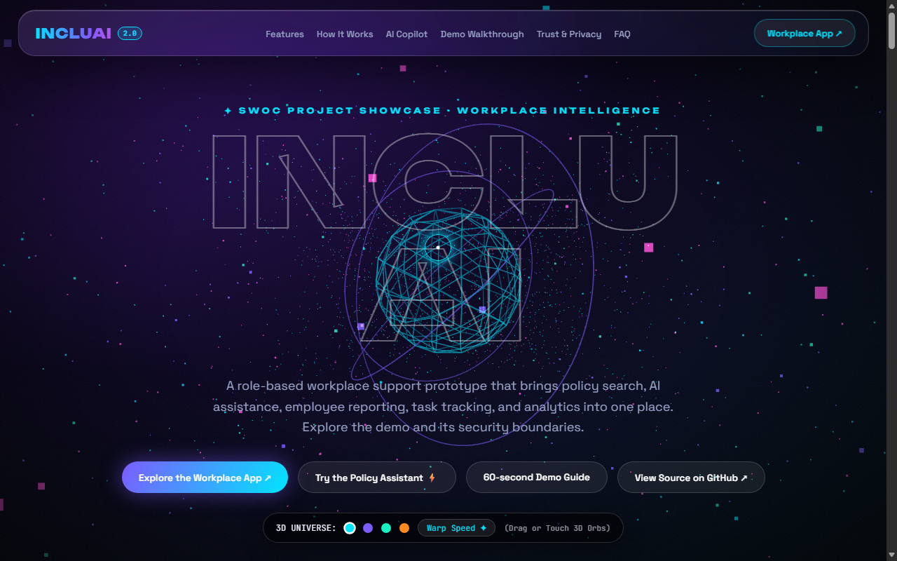
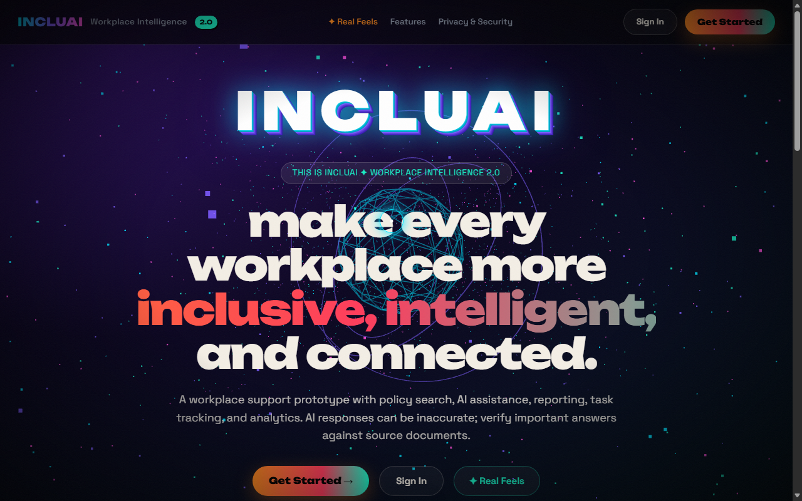
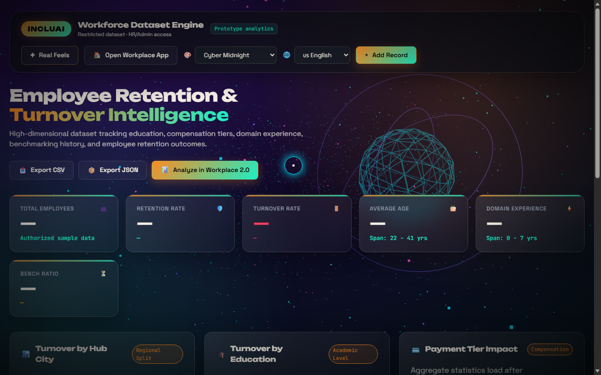

# INCLUAI 2.0

**A role-based AI workplace support prototype** for policy search, employee reporting, task tracking, and workplace analytics.

INCLUAI brings common workplace support workflows into one demo application. It is built as a student project showcase: the interface uses sample/demo data, and the project is not a certified or production-ready HR system.

## What you can explore

- **Policy assistant:** Ask questions about indexed policy documents and inspect available citations. AI answers can be incomplete or incorrect; verify important information against the source.
- **Workplace reports:** Submit identified or anonymous reports. Anonymous submissions omit the submitter account ID, but report text is not automatically scrubbed and may identify its author.
- **Knowledge base:** Search uploaded documents; document upload is restricted to HR/Admin roles.
- **Role-based workplace app:** Employee, HR, and Organization Admin experiences with tasks, reports, and settings.
- **Analytics and dataset explorer:** Protected dataset endpoints and dashboard views for authorized users. Individual attrition predictions are disabled.
- **Accessibility controls:** Experimental contrast, focus, font, and motion controls; the app has not been independently audited for WCAG conformance.

## 60-second SWOC demo

1. **Introduce the problem (10 sec):** workplace policies, reporting, and support tasks can be scattered across tools.
2. **Show the policy assistant (20 sec):** ask a question, point out the source citation, and explain why important answers should be checked against the policy.
3. **Show reporting (10 sec):** compare identified and anonymous submission, noting that free-text descriptions can still reveal identity.
4. **Show role-based access (15 sec):** open the workplace app and demonstrate the employee and HR/Admin workflows. Dataset and company-wide report access require authorization.
5. **Close with the boundary (5 sec):** this is a prototype using local JSON storage and demo data—not a compliance-certified or automated employment decision system.

## Screenshots

These screenshots show the public landing page, workplace app entry point, and role-protected dataset view:







Use synthetic/demo content only. Do not include real employee records, private reports, credentials, or `.env` values in screenshots or recordings.

## Run locally

**Requirements:** Node.js 18 or newer.

```powershell
npm.cmd install
npm.cmd test
npm.cmd start
```

Open:

- Landing page: <http://localhost:5000/>
- Workplace app: <http://localhost:5000/app>
- Dataset explorer: <http://localhost:5000/dataset.html>
- Health check: <http://localhost:5000/api/v2/observability/health>

The app uses local JSON files by default. Keep `.env`, `data/db.json`, and uploaded documents private. For isolated runs, `INCLUAI_DATA_DIR` selects the writable database folder and `INCLUAI_DATASET_DIR` optionally selects the folder containing `employee_attrition.json` and `employee_attrition.csv`; the dataset API remains role-protected. Tests configure isolated temporary database and dataset folders; they do not need production credentials or a Gemini API key.

For a deployment, configure a stable `JWT_SECRET` of at least 32 characters and set `NODE_ENV=production`. Never use the development demo accounts or sample data in a public deployment. Gemini integration is optional; without provider configuration, AI features use the app's offline behavior where supported.

## Security and prototype boundaries

- Protected API routes require authentication and role checks; the static site does not expose the database or dataset files.
- The default persistence layer is a local JSON file, not a managed production database. Backups, retention, and operational monitoring need deployment-specific design.
- Anonymous report submission omits the submitter account ID, but it does not guarantee anonymity if the report text contains identifying details.
- AI output is not guaranteed to be accurate, complete, or grounded in every case. Validate important answers against source documents.
- No SOC 2, GDPR, WCAG, or other regulatory certification is claimed. The project has not received an independent security audit.
- Analytics are for human review and must not be used by themselves to make hiring, promotion, termination, or other employment decisions.

## Technology

- Node.js and Express
- Plain HTML, CSS, and JavaScript frontend
- JWT authentication and role-based API authorization
- Local JSON persistence for the prototype
- Optional Google GenAI integration

## Validation

Run the API and live-integration suites with:

```powershell
npm.cmd test
```

The live tests validate the configured offline/degraded behavior when no Gemini key is present; they do not require a live third-party AI account.

## Repository

Source: <https://github.com/jgourav8900-droid/incluai-2.0>

The package metadata currently declares the ISC license; confirm that a matching license file is included before redistributing the project.
